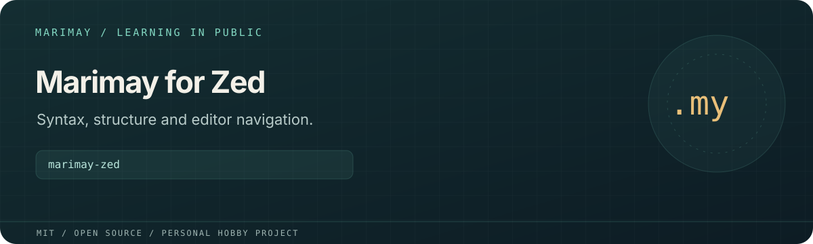

# marimay-zed



> **Personal learning project.** This open-source MIT project is part of
> [Marimay](https://github.com/marimay-lang/marimay), my hobby programming-language project.
> I maintain it in my spare time to learn by building. APIs and tooling may
> change, and progress may be intermittent.

A Zed language extension for Marimay: `.my` file detection, syntax highlighting,
bracket matching, indentation, outline, text objects and structural navigation.

**Status:** Experimental editor support. Version `0.1.1` targets Marimay `0.1.0-alpha.1`
and its `0.1-design` language surface. A language server has not been implemented.

## Run and verify

```sh
./scripts/check
# For a grammar checkout elsewhere:
MARIMAY_TREE_SITTER_REPO=/absolute/path/to/tree-sitter-marimay ./scripts/check
```

## Development installation

In Zed, run **zed: install dev extension** and select this directory.
`extension.toml` pins an exact Tree-sitter grammar revision.

First install the dependencies and build/test the sibling
[`tree-sitter-marimay`](https://github.com/marimay-lang/tree-sitter-marimay) checkout, then run the
checks above. The check compiles all Zed queries against the grammar and runs
them over the representative all-productions fixture. Current scripts name a
`.dylib` artifact; other platforms need their own validation.

## License

[MIT](LICENSE). Existing copyright attribution is retained.
